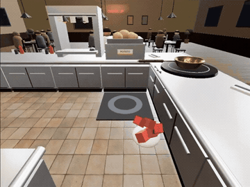
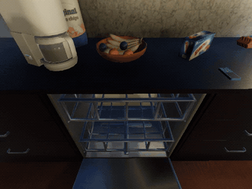
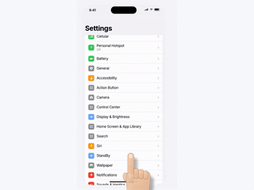

<p align="center">
  
</p>
<h1 align="center">Interactive Visual Gym</h1>
<p align="center"><strong>Evaluating Visual Interaction Models with Simulated Users in Interactive Worlds</strong></p>
<p align="center">University of Washington &nbsp; · &nbsp; Salesforce AI Research</p>

<p align="center">
  <a href="https://interactive-visual-gym.salesforceairesearch.com/"></a>
  <a href="https://arxiv.org/abs/2611.08286"></a>
  <a href="https://interactive-visual-gym.salesforceairesearch.com/#evaluation"></a>
  <a href="https://interactive-visual-gym.salesforceairesearch.com/#leaderboard-section"></a>
</p>
<p align="center">
  <a href="#get-started">Get started</a> &nbsp; / &nbsp;
  <a href="docs/evaluating_assistants.md">Evaluate your model</a> &nbsp; / &nbsp;
  <a href="#submit-via-pull-request">Submit via pull request</a> &nbsp; / &nbsp;
  <a href="#citation">Citation</a>
</p>

**Visual guidance changes what happens next.** Interactive Visual Gym evaluates and trains visual interaction models in a closed loop: a simulated user plans and acts, while the model observes the activity and provides guidance. Scheduled out-of-plan events and user personas let us measure how that guidance affects task execution and interaction quality.

<table>
  <tr>
    <th width="33%">Cooking</th>
    <th width="34%">Household activities</th>
    <th width="33%">Mobile interfaces</th>
  </tr>
  <tr>
    <td align="center"><a href="cooksim/"></a></td>
    <td align="center"><a href="vhhome/"></a></td>
    <td align="center"><a href="screensim/"></a></td>
  </tr>
  <tr>
    <td><strong><a href="cooksim/">CookSim</a></strong><br>Prepare and serve recipes in an Overcooked-style kitchen.</td>
    <td><strong><a href="vhhome/">VH-Home</a></strong><br>Complete household routines in furnished apartments.</td>
    <td><strong><a href="screensim/">ScreenSim</a></strong><br>Configure phone settings to satisfy user goals.</td>
  </tr>
</table>

- **Executable environments.** Visual observations, semantic actions, and scene-graph states support task execution and progress tracking.
- **Controllable users.** Schedule errors, questions, proactive requests, and plan changes at task-progress checkpoints; vary skill, trust in AI, execution speed, and interruption preference.
- **Closed-loop evaluation.** Measure task success, error detection, interaction quality, and question answering from the resulting trajectories.

> [!TIP]
> **Have a model to evaluate? [Submit it to IVG-Bench via a pull request.](docs/submissions.md)** Run the benchmark, upload your trajectories, and add a submission request. Validation is automatic; official scoring and leaderboard publication follow maintainer review.

## Get started

Clone the repository, then follow the quickstart for your environment. Install from the checkout: each engine uses assets and benchmark definitions alongside its Python packages.

```bash
git clone https://github.com/SalesforceAIResearch/Interactive-Visual-Gym.git
cd Interactive-Visual-Gym
```

| Environment | Install and run one episode | Evaluate your model | Create cases |
|---|---|---|---|
| **CookSim** | [Quickstart](cooksim/docs/GETTING_STARTED.md) | [Evaluation](cooksim/docs/EVALUATE_YOUR_MODEL.md) | [Case generation](cooksim/docs/GENERATE_CASES.md) |
| **VH-Home** | [Quickstart](vhhome/docs/GETTING_STARTED.md) | [Evaluation](vhhome/docs/EVALUATE_YOUR_MODEL.md) | [Case generation](vhhome/docs/GENERATE_CASES.md) |
| **ScreenSim** | [Quickstart](screensim/docs/GETTING_STARTED.md) | [Evaluation](screensim/docs/EVALUATE_YOUR_MODEL.md) | [Case generation](screensim/docs/GENERATE_CASES.md) |

Each engine is independently installable. The shared workflow is **inspect cases → run an episode → inspect the record → score → run the benchmark**; simulator dependencies, action vocabularies, and record formats are documented in the guides above.

## Evaluation protocol

**IVG-Bench** contains 105 cases, evaluated with three personas per case: **150 cooking, 75 household, and 90 mobile-interface episodes** per model per run. A case specifies a task and scheduled events; an episode is one execution with a particular user persona and model.

| Evaluation setting | CookSim and VH-Home | ScreenSim |
|---|---|---|
| **Fixed timing** · main comparison | Fixed two-tick delay: `--latency 2` | Fixed zero-tick action–response setting |
| **Measured latency** · latency comparison | Measured inference delay: `--latency measured` | Same fixed setting |

See the [complete run commands](docs/evaluating_assistants.md#response-timing), [benchmark protocol](docs/benchmark_protocol.md), and [metric definitions](docs/metrics.md). Published results are available in the [paper](https://arxiv.org/abs/2611.08286) and on the [project leaderboard](https://interactive-visual-gym.salesforceairesearch.com/#leaderboard-section).

## Submit via pull request

**Submit your model to IVG-Bench by opening a pull request in this repository.**

1. **Run and package.** Run the benchmark and package your trajectories with `ivg-submit`.
2. **Upload the archive.** Use a GitHub Release asset and generate a submission request containing its URL and checksum. Include a pinned inference-code repository and runnable instructions in your submission metadata.
3. **Open a PR.** Add **`submissions/requests/<submission-id>.json`**—not the trajectory archive or inference code itself.

PR validation checks the submitted records automatically. Maintainers then grade and review the results before approving leaderboard publication.

**[Submission guide: commands, required files, and review process →](docs/submissions.md)**

## Documentation

| Guide | Contents |
|---|---|
| [Getting started](docs/getting_started.md) | Requirements, installation, and your first run |
| [Evaluating models](docs/evaluating_assistants.md) | Model interfaces, run commands, and outputs |
| [Benchmark protocol](docs/benchmark_protocol.md) | Cases, personas, repeated runs, and configuration |
| [Metrics](docs/metrics.md) | Engine-derived scores and model-judged interaction quality |
| [Submitting results](docs/submissions.md) | Trajectory packaging, official scoring, and inference-code audit |
| [Development](docs/developing.md) | Repository structure, tests, and compatibility checks |
| [Validation](docs/validation.md) · [Release notes](docs/release_notes.md) | Validation checks, limitations, and configuration differences |

<details>
<summary><strong>Repository structure</strong></summary>

```text
cooksim/                Cooking engine, assets, benchmark harness, and tests
vhhome/                 Household engine, simulator setup, benchmark harness, and tests
screensim/              Phone engine, assets, benchmark harness, and tests
docs/                   Shared workflow and benchmark documentation
scripts/                Repository-wide validation
ivg_submission/         Submission validation, grading handoff, and leaderboard export
submissions/            Submission requests and maintainer-reviewed results
```

</details>

## Citation

If you use Interactive Visual Gym in your research, please cite our paper:

```bibtex
@misc{zheng2026interactivevisualgymevaluating,
      title={Interactive Visual Gym: Evaluating Visual Interaction Models with Simulated Users in Interactive Worlds},
      author={Chenhao Zheng and Zixian Ma and Kai Li and Kanchana Ranasinghe and Jieyu Zhang and Artemis Panagopoulou and Weikai Huang and Jianxu Shangguan and Yuanyuan Tan and Silvio Savarese and Juan Carlos Niebles and Ranjay Krishna and Ran Xu and Honglu Zhou},
      year={2026},
      eprint={2611.08286},
      archivePrefix={arXiv},
      primaryClass={cs.CV},
      url={https://arxiv.org/abs/2611.08286},
}
```

Download [citation.bib](citation.bib), or use [CITATION.cff](CITATION.cff).

## Contributing and licenses

See [CONTRIBUTING.md](CONTRIBUTING.md). This repository is released under the [Apache-2.0 license](LICENSE.txt). CookSim and VH-Home retain their included MIT licenses; ScreenSim carries an [Apache-2.0 license](screensim/LICENSE). External simulators, model weights, and other third-party assets retain their own terms.
