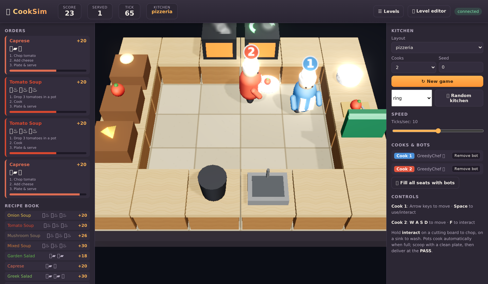

# CookSim

**Cooking tasks in an executable kitchen, with simulated users, scheduled human events, and a visual assistant.**



A simulated cook prepares and serves a recipe while the assistant observes the kitchen and offers guidance. The engine tracks ingredients, preparation, plating order, heat, and task completion.

Part of [Interactive Visual Gym](../README.md). See the shared [benchmark protocol](../docs/benchmark_protocol.md) for definitions and the three-environment evaluation.

## Requirements and installation

Run the commands below from `interactive_visual_gym/cooksim/` in a dedicated Python environment.

Python 3.10+ and Chromium. Start the renderer in a separate terminal with `cooksim-server --port 17773`. Rendering supports a software fallback; locally served models have their own GPU requirements.

```bash
python -m pip install -e ".[dev]"
python -m playwright install chromium
```

Detailed instructions: [Getting started](docs/GETTING_STARTED.md).

## Run one episode

```bash
export GEMINI_API_KEY=...
cooksim-episode --latency 2 --case b3_easy_nops_medium_map_2 --persona baseline \
    --assistant gemini:gemini-3.8-flash --out runs/demo
```

The episode record is written under `runs/demo/frames/baseline/gemini-3.8-flash/`.

## Evaluate an assistant

```bash
cooksim-benchmark --latency 2 --assistant gemini:gemini-3.8-flash --out runs/gemini --workers 4
cooksim-score --run runs/gemini --only objective
# Interaction-quality grading makes API calls to the configured judges:
cooksim-score --run runs/gemini --only rubric --judges gemini,gpt
```

Objective scoring reads saved records without model calls. Interaction-quality grading requires the configured judge credentials. Follow [Evaluate your model](docs/EVALUATE_YOUR_MODEL.md) for integration and [Reproduce results](docs/REPRODUCE.md) for independent runs and aggregation.

## Create custom cases

Start by inspecting the available tasks and event schedules:

```bash
cooksim-case list
cooksim-case show b3_medium_nops_medium_map_3
```

See [Generate cases](docs/GENERATE_CASES.md) for supported customization and validation.

## Documentation

| Guide | Contents |
|---|---|
| [Getting started](docs/GETTING_STARTED.md) | Installation, credentials, first episode, and troubleshooting |
| [Evaluate your model](docs/EVALUATE_YOUR_MODEL.md) | Assistant interface and evaluation workflow |
| [Benchmark](docs/BENCHMARK.md) | Tasks, cases, personas, events, and metrics |
| [Reproduce results](docs/REPRODUCE.md) | Run configuration, repeats, and scoring |
| [Generate cases](docs/GENERATE_CASES.md) | Create and validate custom evaluation cases |
| [Assistants](docs/ASSISTANTS.md) | Supported model configurations |
| [Interaction quality](docs/INTERACTION_QUALITY_GRADING.md) | Judge inputs, rubric, and aggregation |
| [Engine](docs/ENGINE.md) | State, actions, rendering, and engine API |

[Engine and episode overview](docs/OVERVIEW.md) · [Add a backend](docs/ADD_A_BACKEND.md) · [Project leaderboard](https://hellomuffin.github.io/ive-benchmark/redesign/#leaderboard-section)

## Development

From the repository root, run `python scripts/check_release.py --engine cooksim --tests` using this environment's Python. See the shared [development guide](../docs/developing.md) for testing boundaries and compatibility checks.

## Citation and license

Use the project [citation](../CITATION.cff). MIT; see [LICENSE](LICENSE).
