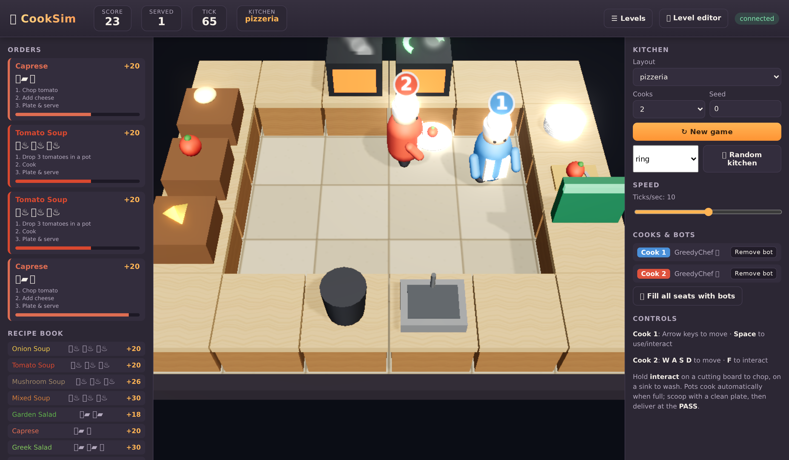

# CookSim

**A kitchen simulator and benchmark for proactive visual assistants.**



CookSim puts a model in the seat of a kitchen assistant. A simulated cook, played by a language model with a persona, prepares one order in a 3D kitchen. At scheduled moments the engine takes over the cook's hands and makes it commit a real mistake (plating raw fish, stacking a burger in the wrong order, walking away from a pan), and the cook asks questions and makes requests. The assistant under test watches the kitchen through rendered frames and can speak at any time. It is scored on whether the dish is served, whether it names each mistake before the mistake lands, how well it answers, how many false alarms it raises, and how good each thing it says is at the moment it says it. The seconds the assistant spends thinking are charged to the game clock, so a slow warning is a late warning.

## How an episode works

| Piece | What it is |
|---|---|
| **Cook** | A Gemini model with a persona (skill, trust in the assistant). It plans the dish itself from the order card and the kitchen rulebook and acts one command at a time: `go to potato source 2`, `pick up`, `chop`, `turn on`, `scoop`, `serve`. |
| **Assistant** | The model under test. Every 2 ticks it receives the last 8 frames (or a text state map), the conversation so far and the kitchen rulebook, and returns a spoken line plus an optional typed flag naming a mistake, e.g. `{"error": "wrong_order"}`. A reply that took *x* seconds arrives `ceil(x / 1.2)` ticks later (at most 30). |
| **Case** | One order on one kitchen map plus a schedule of sub-cases: **errors** the engine forces, **questions** with a known answer, **standing requests** ("tell me when the meat is done") and **plan changes**. Each sub-case fires when the live kitchen reaches its anchor (what is plated and prepped), never on a timer, so it fires whatever order the cook works in. |
| **Takeover** | While an error is live the cook's body executes the mistake and its voice defends it. If the assistant names the mistake with the right flag, the cook can accept the correction and repair. If nobody catches it, the mistake commits and the takeover ends on its own. |
| **Outcome** | `won` (the correct dish was served), `wrong_serve`, `burned` (food left on the heat caught fire) or `timeout`. One tick is 1.2 s of game time. Food that is done stays safe for 40 ticks, then smokes; 45 ticks later it is burnt and the episode is over. |

The shipped suite has 50 cases: 5 recipe tiers x 2 kitchen maps (`medium_map`, `hard_map`) x 5 cases. Case names read `b3_<tier>_nops_<map>_<1-5>`, for example `b3_easy_nops_medium_map_2`.

| Tier | Recipe (plated in this order) | Forced mistakes per case |
|---|---|---|
| `easy` | Caprese: chopped tomato, cheese | 2 |
| `medium` | Cheeseburger: bun, cooked meat, cheese | 2 |
| `hard` | Fish & chips: fried fish, fried potato, fried potato | 3 |
| `expert` | Steak frites: seared steak, fried potato, fried potato | 4 |
| `master` | Burrito: tortilla, rice, steak, chopped tomato, chopped lettuce | 3 |

Every case also carries questions and a standing request; some carry a plan change. The formal protocol plays every case with 3 cook personas (`baseline`, `classic_novice`, `classic_expert`), 150 episodes per assistant per run, and averages 3 independent runs.

**Leaderboard:** [results/README.md](../results/README.md).

## Quickstart

### Install

Python 3.10 or newer. The renderer is a headless Chromium page driven by Playwright.

```bash
conda env create -f environment.yml      # python 3.11, ffmpeg, and `pip install -e .[anthropic,video,dev]`
conda activate cooksim
playwright install chromium               # the headless renderer
playwright install-deps chromium          # its system libraries (Linux; needs sudo)
```

Without conda: `pip install -e .` in a Python 3.10+ environment, then the two `playwright` commands.

### API keys

```bash
export GEMINI_API_KEY=...        # required: the simulated cook is a Gemini model
export OPENAI_API_KEY=...        # GPT assistants, the GPT rubric judge, the cook's voice for native streaming seats
export ANTHROPIC_API_KEY=...     # optional: the Claude assistant and judge
```

### Start the renderer

Leave it running in its own terminal:

```bash
cooksim-server --port 17773
```

### Run one episode

```bash
cooksim-episode --case b3_easy_nops_medium_map_2 --persona baseline \
    --assistant gemini:gemini-3.8-flash --out runs/demo
```

The record lands at `runs/demo/frames/baseline/gemini-3.8-flash/b3_easy_nops_medium_map_2.json`. An easy case takes a few minutes. `cooksim-roster` lists the assistants we evaluated; any of their tags works in place of `gemini:gemini-3.8-flash`, as does any OpenAI-compatible endpoint (`--assistant openai:<served-name> --base-url http://127.0.0.1:18300/v1`).

### Run the benchmark and score it

```bash
cooksim-benchmark --assistant gemini:gemini-3.8-flash --out runs/gemini --workers 4   # 150 episodes, resumable
cooksim-benchmark --assistant gemini:gemini-3.8-flash --out runs/gemini --repeat 2
cooksim-benchmark --assistant gemini:gemini-3.8-flash --out runs/gemini --repeat 3
cooksim-score --run runs/gemini
```

`cooksim-score` grades the task outcome and detection (no API calls), the question answers, the proactive alerts and the interaction-quality rubric, then prints the leaderboard rows. See [docs/EVALUATE_YOUR_MODEL.md](EVALUATE_YOUR_MODEL.md).

## Make your own cases

`cooksim-case` composes new cases from the suite's verified parts and replays them with a scripted cook to prove the schedule fires:

```bash
cooksim-case derive --from b3_medium_nops_medium_map_3 --name my_burger_1 \
    --drop wrong_order --add-error leave_unattended:meat --add-question next_step --out my_cases.json
cooksim-case verify my_cases.json
cooksim-episode --cases my_cases.json --case my_burger_1 --persona classic_novice --assistant gemini:gemini-3.8-flash --out runs/mine
```

Details in [docs/GENERATE_CASES.md](GENERATE_CASES.md).

## Documentation

| Page | What it covers |
|---|---|
| [docs/GETTING_STARTED.md](GETTING_STARTED.md) | Installation in detail, keys, the renderer, your first episode and how to read its record, first scoring, common problems |
| [docs/EVALUATE_YOUR_MODEL.md](EVALUATE_YOUR_MODEL.md) | Putting your own model in the assistant seat; the full three-run protocol; what the assistant receives and must return |
| [docs/GENERATE_CASES.md](GENERATE_CASES.md) | Composing and verifying new cases with `cooksim-case` |
| [docs/BENCHMARK.md](BENCHMARK.md) | The suite, the metrics and the formal protocol |
| [docs/REPRODUCE.md](REPRODUCE.md) | Reproducing the published numbers |
| [docs/ASSISTANTS.md](ASSISTANTS.md) | Every evaluated assistant: backends, flags, serving the open-weight models |
| [docs/INTERACTION_QUALITY_GRADING.md](INTERACTION_QUALITY_GRADING.md) | The interaction-quality rubric and its judges |
| [docs/ADD_A_BACKEND.md](ADD_A_BACKEND.md) | Adding a new assistant backend class or a native streaming seat |
| [docs/ENGINE.md](ENGINE.md) | The kitchen simulator on its own: Python API, Gymnasium/PettingZoo environments, browser |

## Repository layout

```
cooksim/                engine: cooksim.core (game, recipes, stations, errors), cooksim.interact (personas,
                        kitchen rules, protocol, takeover windows), cooksim.agents (scripted cooks, observers),
                        cooksim.envs (Gymnasium / PettingZoo), cooksim.server (FastAPI + renderer)
cooksim_bench/          benchmark harness
  e2e_stepin_rollout.py   one episode: cook + assistant + scheduled sub-cases
  run_assist_bench.py     one assistant over the suite, resumable, N workers
  roster.py               every assistant we evaluated, with its exact flags (cooksim-roster)
  exp_interact.py         builds an episode (kitchen, recipe, cook) for a cell
  backends/               assistant and cook model clients: OpenAI-compatible, Gemini, Anthropic,
                          polled and native streaming
  scoring/                objective scoring, QA and proactive-alert judges, interaction-quality rubric, seat table
  suite/                  the suite designer, verifier and inventory tools
  video/                  films from records
  cli/                    cooksim-episode, cooksim-benchmark, cooksim-score, cooksim-case
benchmark/              the 50-case suite, kitchen maps, verified-mistake inventory, efficiency references,
                        cook-ablation cells, design ledger
web/                    the WebGL renderer (headless_render.html) and the interactive game page
serving/                scripts and shims that serve the open-weight assistants (vLLM or the authors' code)
docs/                   documentation
results/                leaderboard tables and the numbers behind the paper
tests/, examples/
```

## Citation

Use the shared project metadata in [CITATION.cff](../../CITATION.cff).

## License

MIT. See [LICENSE](../LICENSE).
